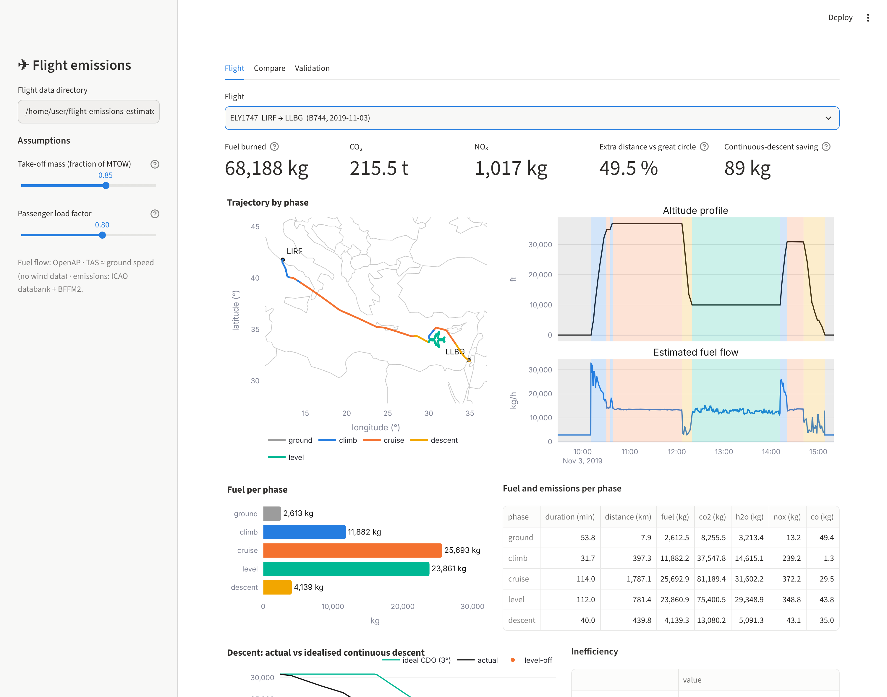
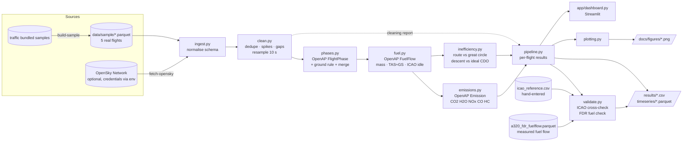
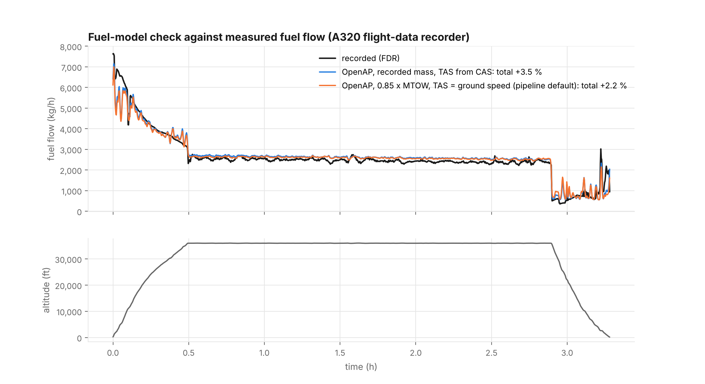
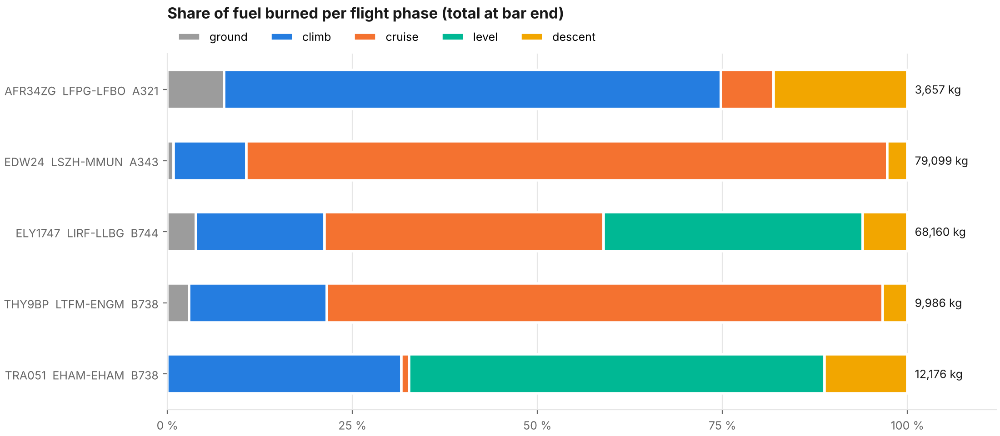
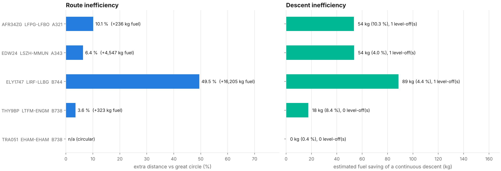
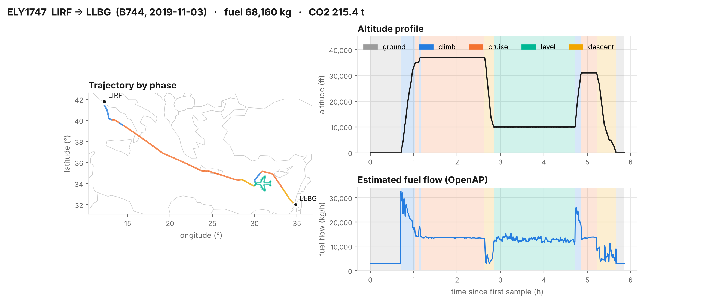
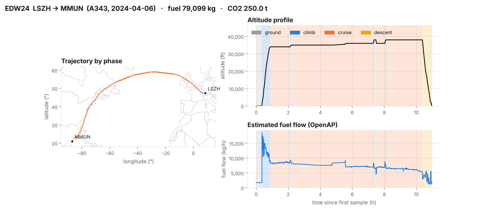
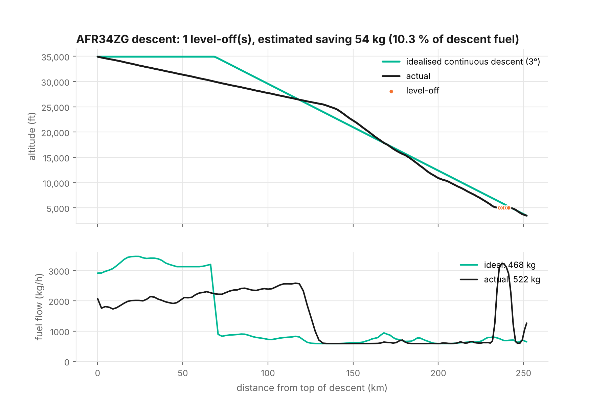
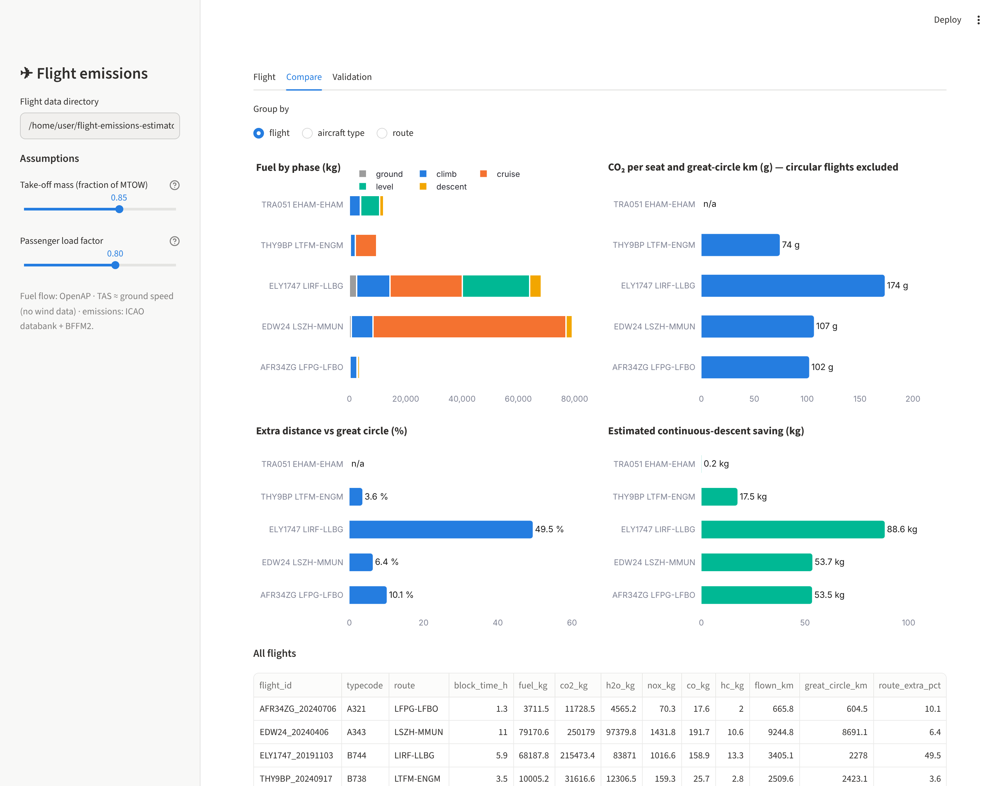

# Flight Emissions Estimator

[](https://github.com/Abhishek2993/flight-emissions-estimator/actions/workflows/ci.yml)


This project estimates fuel burn and emissions (CO₂, H₂O, NOₓ, CO, HC) for real flights from
their ADS-B trajectories, broken down by flight phase, and measures two kinds of operational
inefficiency. The first is extra distance flown compared with the great circle. The second
is fuel lost to level-offs and shallow, powered segments in the descent, compared with an
idealised continuous descent. The pipeline cleans and resamples each trajectory, segments it
into phases with OpenAP's fuzzy-logic classifier, and estimates fuel flow sample by sample
with the OpenAP performance model. Emissions come from the ICAO engine emissions databank
through Boeing Fuel Flow Method 2. Results are checked two ways: against fuel flow measured
by an A320 flight-data recorder, and against values from the ICAO Carbon Emissions
Calculator. The bundled sample runs fully offline, and a Streamlit dashboard lets you
explore every flight.



---

## Contents

1. [Requirements](#1-requirements)
2. [Architecture](#2-architecture)
3. [Assumptions and limitations](#3-assumptions-and-limitations)
4. [Hazard and failure analysis](#4-hazard-and-failure-analysis)
5. [Results](#5-results)
6. [How to run](#6-how-to-run)
7. [Project layout and testing](#7-project-layout-and-testing)

A plain-language walkthrough of every module, formula and design decision is in
[docs/LEARNING.md](docs/LEARNING.md).

---

## 1. Requirements

### Functional requirements

| ID | Requirement | Implemented in | Verified by |
|---|---|---|---|
| FR-1 | Load trajectories from parquet/CSV files and from `traffic` objects and normalise them to one schema (`timestamp, lat, lon, altitude_ft, groundspeed_kt, vertical_rate_fpm, track, icao24, callsign, typecode`). | `ingest.py` | `test_ingest.py` |
| FR-2 | Optionally download a flight from the OpenSky Network, reading credentials only from environment variables. | `ingest.load_opensky`, CLI `fetch-opensky` | `test_opensky_credentials_from_environment` |
| FR-3 | Remove duplicates, position and altitude spikes and implausible values; interpolate short gaps; resample to a uniform step (default 10 s); log how many points were removed and why. | `clean.py` | `test_clean.py` |
| FR-4 | Segment every flight into ground / climb / cruise / level / descent with OpenAP `FlightPhase`, merging segments shorter than a configurable duration. | `phases.py` | `test_phases.py` |
| FR-5 | Estimate fuel flow per time step with OpenAP `FuelFlow` from aircraft type, TAS, altitude and vertical rate, with a configurable take-off mass (default 0.85 × MTOW), and integrate fuel per phase. | `fuel.py` | `test_fuel.py` |
| FR-6 | Compute CO₂, H₂O, NOₓ, CO and HC per phase and per flight with OpenAP `Emission`. | `emissions.py` | `test_emissions.py` |
| FR-7 | Report flown distance vs great-circle distance between the first and last airborne points, as % extra distance and the extra fuel it implies. | `inefficiency.route_inefficiency` | `test_inefficiency.py` |
| FR-8 | Detect level-offs inside the descent and estimate the fuel saving of an idealised continuous descent between the same start and end altitudes. | `inefficiency.descent_analysis` | `test_inefficiency.py` |
| FR-9 | Compare per-flight CO₂ with hand-entered ICAO Carbon Emissions Calculator values and report the % difference. | `validate.compare_with_icao` | `test_validate.py` |
| FR-10 | Provide a CLI (`python -m flight_emissions run --input … --out …`) that writes CSV summaries and PNG figures. | `cli.py`, `pipeline.py`, `plotting.py` | `test_pipeline.py` |
| FR-11 | Provide a dashboard with a per-flight view (map by phase, altitude profile, fuel and emissions per phase, inefficiency) and a cross-flight comparison by flight, aircraft type or route. | `app/dashboard.py` | Demonstration (screenshots below) |

### Non-functional requirements

| ID | Requirement | How it is met |
|---|---|---|
| NFR-1 | **Offline by default**: the shipped sample, maps and validation run without network access. | Sample flights in `data/sample/`, Natural Earth boundaries bundled in the package, no tile servers. |
| NFR-2 | **Reproducible**: same inputs and configuration give the same numbers. | Direct dependencies pinned in `pyproject.toml`; every threshold in one frozen `PipelineConfig`, saved to `run_config.json` with each run. |
| NFR-3 | **Traceable**: every number in this README comes from an actual run. | Tables in §5 are copied from `results/` by `scripts/update_readme.py`. |
| NFR-4 | **Robust**: one bad flight must not stop a batch. | Flights that cannot be modelled get a `status` (e.g. `skipped: cannot model aircraft type`) and the run continues. |
| NFR-5 | **Transparent**: data-quality problems are reported, not hidden. | Per-flight cleaning report, warnings for data gaps, fallback types and type/trajectory mismatches. |
| NFR-6 | **Quality**: type hints and docstrings throughout; lint-clean; unit tests with ≥ 70 % coverage, enforced in CI. | `ruff` + `pytest --cov-fail-under=70` in GitHub Actions; current coverage 98 %. |
| NFR-7 | **Performance**: the full sample (5 flights, ~27 hours of trajectory data) processes in seconds on a laptop. | Vectorised OpenAP calls; uniform 10 s grid. |
| NFR-8 | **Security**: no credentials in code, configuration or history. | OpenSky credentials read only from `OPENSKY_USERNAME` / `OPENSKY_PASSWORD`; `.env` ignored by git. |

---

## 2. Architecture



**Data flow per flight.** A raw trajectory is normalised to the canonical schema, cleaned
and resampled, labelled by phase, and then passed through the fuel model. Fuel flow feeds
the emission model and the inefficiency analysis. Everything is collected in a
`FlightResult`, which the CLI writes to CSV/parquet/PNG and the dashboard renders
interactively. The validation stage runs once per batch.

---

## 3. Assumptions and limitations

| # | Assumption / limitation | Why it is acceptable | Effect on results |
|---|---|---|---|
| A-1 | **Take-off mass = 0.85 × MTOW** (configurable), then reduced by the fuel burned. | ADS-B does not carry mass. 0.85 is a typical mid-range value for scheduled flights. | First-order: fuel moves by roughly ±10–15 % for ±0.15 of MTOW (sensitivity table in §5). Short flights usually take off lighter, long flights heavier, so the fixed fraction overestimates short-haul fuel and underestimates long-haul fuel. |
| A-2 | **True airspeed ≈ ground speed** (no wind). | Wind is not in ADS-B data. Using a `tas_kt` column (e.g. Mode S EHS or a weather model) is supported. | On the A320 recorder flight, using ground speed raises the total-fuel error from +3.5 % to +5.5 % (§5). In jet-stream conditions the per-segment error can be larger, partly cancelling over a round trip. |
| A-3 | **OpenAP model accuracy.** Clean configuration (no flaps or gear), drag polar and fuel model fitted to public data, acceleration ignored in the main fuel estimate. | It is the best openly available model with type-specific parameters for most airliners. | +3.5 % total fuel, 10.5 % mean per-sample error, correlation 0.97 against measured A320 fuel flow (§5). Accuracy for other types is not verified here. |
| A-4 | **Taxi at ICAO idle fuel flow (7 % thrust); take-off roll at take-off thrust; landing roll at idle.** | ICAO LTO-cycle convention used in emission inventories. OpenAP's drag model is not valid on the runway. | Reverse thrust, single-engine taxi and APU fuel are not modelled. |
| A-5 | **Emission indices** from the ICAO engine databank for OpenAP's *default* engine of each type, via BFFM2. | The actual engine variant is not in ADS-B data. | NOₓ/CO/HC carry the uncertainty of BFFM2 (typically ±10–20 % for NOₓ). CO₂ and H₂O are exact multiples of fuel (3.16 and 1.23). |
| A-6 | **Gaps longer than 5 min** are not interpolated. Fuel across a gap is integrated assuming linear change in fuel flow. | Inventing points over an ocean would be false precision. In cruise, fuel flow changes slowly. | Flown distance across a gap is a straight line (a lower bound). Gaps are reported per flight (EDW24: 153 min). |
| A-7 | **Route inefficiency** uses the first/last *airborne* points, and extra fuel uses the flight's *cruise* fuel per km. | Airport positions are not needed, and the method works for any coverage window. | Extra distance flown low down (vectoring) costs more per km than cruise, so the extra-fuel figure is conservative. Round trips (< 100 km between end points) are flagged as not applicable. |
| A-8 | **Descent analysis**: from top of the final descent to 3,000 ft above the landing altitude. The ideal is a 3° continuous descent over the same ground distance at the same calibrated airspeed. Level flight = \|vertical rate\| < 300 ft/min for ≥ 20 s. | The level-flight definition is the harmonised EUROCONTROL/FAA one. Below ~3,000 ft the ILS intercept level segment is procedural. | The saving includes level-offs *and* shallow powered segments, so it is an upper bound on what a CDO could save, given the model. |
| A-9 | **ICAO comparison** is per flight and per passenger (seats × 0.80 load factor). | It is the only public reference available per route. | ICAO uses route-average aircraft, great-circle distance plus a correction, load factors and a cargo share, so differences of tens of percent are expected (see `validate.KNOWN_DIFFERENCE_REASONS`). |
| A-10 | **Barometric altitude** is used as reported. Altitudes are not corrected for local pressure (QNH). | Below the transition altitude the error is a few hundred feet. | Only affects phase boundaries near the ground and the landing altitude of the descent analysis. |

---

## 4. Hazard and failure analysis

How the pipeline behaves when its inputs are wrong, and how each problem is detected or
mitigated. Each mitigation has a unit test.

| ID | Hazard (input problem) | Effect if unmitigated | Detection | Mitigation | Residual risk | Verified by |
|---|---|---|---|---|---|---|
| H-1 | **Data gaps** (receiver coverage, oceanic crossings) | Missing fuel for the gap; spurious interpolated track. | Interval between position reports: > 30 s = gap, > 300 s = long gap. Counted in `cleaning_report.csv` and logged as a warning. | Short gaps interpolated linearly. Long gaps left open: no invented points, and fuel integrated linearly across the gap. | Manoeuvres inside a long gap are invisible, and distance is a lower bound. | `test_short_gap_interpolated_long_gap_left_open`, `test_gap_is_bridged_linearly`, `test_long_gap_produces_warning` |
| H-2 | **Wrong aircraft type code** (e.g. A320 tagged as B744) | Fuel wrong by a factor of 2–4. | Plausibility check: altitude above the type's ceiling, or median cruise ground speed > 35 % away from the type's cruise Mach. | Warning on the flight; sample types were cross-checked against a public icao24→type database. | A wrong type within the same class (A320 vs A321) is not detectable from the trajectory. | `test_type_plausibility_flags_impossible_altitude_and_speed` |
| H-3 | **Missing type code** (ADS-B never transmits it) | No model can be selected. | `typecode` empty after ingest. | Flight **skipped** with an explicit status, unless `--fallback-typecode` is set; then it is modelled with a warning. OpenAP synonyms are used for close variants (e.g. B762→B763). | With a fallback the result is only indicative. | `test_missing_typecode_is_skipped_or_uses_fallback`, `test_resolve_synonym_and_fallback` |
| H-4 | **Unsupported type** (e.g. C172, BCS3) | Exception in OpenAP. | `UnsupportedAircraftError` from `resolve_aircraft`. | Flight skipped with status, and the batch continues. | – | `test_resolve_unknown_without_fallback_raises`, `test_run_pipeline_writes_all_outputs` |
| H-5 | **Unrealistic vertical rates** (> 8,000 ft/min, sensor noise) | Thrust and fuel spikes; false level-offs. | Plausibility limit on reported values. | Values beyond ±8,000 ft/min are discarded and re-derived from the altitude derivative. A 30 s moving average is applied before the fuel model. | Sustained wrong but plausible rates pass. | `test_implausible_values_are_rejected`, `test_smoothed_vertical_rate_removes_alternating_noise` |
| H-6 | **Position or altitude spikes** (multipath, decoding errors) | Distance and route inefficiency inflated; false phases. | Implied speed > 800 kt (position) or implied vertical rate > 10,000 ft/min (altitude) on *both* adjacent links. | Position spikes removed; altitude spikes nulled and re-interpolated. Iterated until stable. | Two consecutive spikes close to each other can survive. | `test_position_spike_is_removed`, `test_altitude_spike_is_nulled_not_dropped` |
| H-7 | **Duplicate / partial messages** (several receivers, several message types per second) | Double-counted samples. | Exact duplicates and duplicate timestamps. | Dropped / merged (first non-missing value per column). | – | `test_duplicates_are_removed_and_merged` |
| H-8 | **Airport above sea level** | OpenAP calls taxiing aircraft "level flight". | – | Ground rule: ground speed < 50 kt ⇒ ground, re-applied after segment merging. | – | `test_ground_override_at_elevated_airport` |
| H-9 | **Landing roll labelled airborne** | Clean-configuration drag model returns NaN or huge thrust at 60–120 kt on the runway. | Samples after the last point > 100 ft above landing altitude. | Thrust mode `landing` at idle (ICAO LTO). | Reverse thrust not modelled. | `test_thrust_mode_identifies_landing_roll` |
| H-10 | **Recording ends in cruise / starts airborne** | Descent analysis on the wrong segment. | No descent below the floor after the last climb. | Descent analysis reported as not applicable. | Fuel for the unobserved part is missing (gate-to-gate is only what was seen). | `test_no_descent_window_when_recording_ends_in_cruise` |
| H-11 | **Circular flights** (sightseeing, training) | Division by a near-zero great circle, giving a meaningless %. | End points < 100 km apart. | Route inefficiency reported as not applicable (`n/a (circular)`). | – | `test_circular_flight_is_not_applicable` |

---

## 5. Results

All tables in this section are generated by the pipeline (`results/summary.md`,
`results/sensitivity.md`) and copied in by `scripts/update_readme.py`. The full per-flight
outputs are in `results/` after a run.

### Sample flights

The sample contains five real flights extracted from the `traffic` library's bundled data
(see `data/sample/_catalogue.csv`). Aircraft types were cross-checked by transponder address
against the public [tar1090-db](https://github.com/wiedehopf/tar1090-db) aircraft database.

- **AFR34ZG** Paris CDG → Toulouse, A321 F-GMZC, raw Mode S decoded with rs1090 (2024)
- **THY9BP** Istanbul → Oslo, B737-800 TC-JVF (FlightRadar24 export, 2024)
- **EDW24** Zurich → Cancún, A340-300 HB-JMF, transatlantic with oceanic coverage gaps (2024)
- **ELY1747** Rome → Tel Aviv, B747-400 4X-ELC: El Al's 747 farewell flight, which drew a
  747 over the eastern Mediterranean before landing (2019)
- **TRA051** Amsterdam → Amsterdam, B737-800 PH-HZO: sightseeing round trip, kept as the
  circular-flight reference case (2018)

### Fuel, emissions and inefficiency; ICAO cross-check; fuel-model check

<!-- results:start -->
| Flight | Route | Type | Block time | Fuel (kg) | CO2 (t) | NOx (kg) | Route extra | Extra fuel (kg) | Descent level-offs | CDO saving (kg) |
|---|---|---|---:|---:|---:|---:|---:|---:|---:|---:|
| AFR34ZG | LFPG-LFBO | A321 | 1h20 | 3,657 | 11.6 | 69 | 10.1 % | 236 | 1 | 54 (10.3 %) |
| EDW24 | LSZH-MMUN | A343 | 10h59 | 79,099 | 250.0 | 1,430 | 6.4 % | 4,547 | 1 | 54 (4.0 %) |
| ELY1747 | LIRF-LLBG | B744 | 5h52 | 68,160 | 215.4 | 1,016 | 49.5 % | 16,205 | 1 | 89 (4.4 %) |
| THY9BP | LTFM-ENGM | B738 | 3h32 | 9,986 | 31.6 | 159 | 3.6 % | 323 | 0 | 18 (8.4 %) |
| TRA051 | EHAM-EHAM | B738 | 5h01 | 12,176 | 38.5 | 168 | n/a (circular) | n/a | 0 | 0 (0.4 %) |

| Route | Type | Our CO2 per flight (kg) | ICAO per flight (kg) | Diff | Our CO2 per pax (kg) | ICAO per pax (kg) | Diff | Status |
|---|---|---:|---:|---:|---:|---:|---:|---|
| LFPG-LFBO | A321 | 11,556 | n/a | n/a | 76 | n/a | n/a | awaiting ICAO value |
| LTFM-ENGM | B738 | 31,555 | n/a | n/a | 225 | n/a | n/a | awaiting ICAO value |
| LSZH-MMUN | A343 | 249,953 | n/a | n/a | 1,157 | n/a | n/a | awaiting ICAO value |
| LIRF-LLBG | B744 | 215,384 | n/a | n/a | 494 | n/a | n/a | awaiting ICAO value |

| Fuel-model scenario (A320 recorder data) | Model fuel (kg) | Recorded fuel (kg) | Total error | Per-sample MAPE | Correlation |
|---|---:|---:|---:|---:|---:|
| recorded mass, TAS from CAS | 8,781 | 8,485 | 3.5 % | 10.5 % | 0.97 |
| recorded mass, TAS = ground speed | 8,948 | 8,485 | 5.5 % | 12.9 % | 0.97 |
| 0.85 x MTOW, TAS = ground speed (pipeline default) | 8,674 | 8,485 | 2.2 % | 10.6 % | 0.97 |
<!-- results:end -->

*Route extra* = (flown − great circle) / great circle between the first and last airborne
points. *Extra fuel* = extra km × the flight's cruise fuel per km. *CDO saving* = estimated
descent fuel minus the fuel of an idealised 3° continuous descent over the same distance
(percentage of descent fuel in brackets). *Block time* is the time covered by the data.

**ICAO cross-check.** The ICAO reference values are entered by hand from the
[ICAO Carbon Emissions Calculator](https://www.icao.int/environmental-protection/CarbonOffset/Pages/default.aspx)
into [`data/reference/icao_reference.csv`](data/reference/icao_reference.csv). Rows still
marked *awaiting ICAO value* have not been filled in yet. The pipeline already reports our
side (per flight and per passenger), and the % difference appears once a value is entered
and the run repeated. Expect our per-passenger figures to differ from ICAO's for these
reasons:

1. **Passenger allocation.** ICAO uses route-group load factors and removes a cargo share.
   We divide by typical seats × 0.80 and assign everything to passengers.
2. **Aircraft mix.** ICAO averages over all types on the route; we model the type that flew.
3. **Distance.** ICAO uses great circle + a fixed correction; we use the flown track. This
   is decisive for ELY1747, whose sightseeing pattern adds 49.5 % distance.
4. **Mass.** A fixed 0.85 × MTOW overestimates short-haul take-off mass.
5. **Model error.** About +3.5 % from OpenAP itself on the A320 check, plus the no-wind
   simplification.

**Fuel-model check.** The A320 flight-data-recorder sample in `traffic` contains measured
fuel flow and gross weight. With the *recorded* mass and TAS derived from the recorded
calibrated airspeed, OpenAP overestimates total fuel by 3.5 %. Replacing TAS with ground
speed raises this to 5.5 %. The pipeline default (0.85 × MTOW) lands at +2.2 %, but only
because the assumed mass is lower than the real one, which happens to offset the other
errors. That agreement is luck, not accuracy.



### Sensitivity to the take-off mass assumption

<!-- sensitivity:start -->
| Flight | 0.70 x MTOW | 0.85 x MTOW | 1.00 x MTOW |
|---|---:|---:|---:|
| AFR34ZG_20240706 | 3,270 kg (-10.6 %) | 3,657 kg | 4,070 kg (+11.3 %) |
| EDW24_20240406 | 71,616 kg (-9.5 %) | 79,099 kg | 87,994 kg (+11.2 %) |
| ELY1747_20191103 | 58,970 kg (-13.5 %) | 68,160 kg | 78,614 kg (+15.3 %) |
| THY9BP_20240917 | 8,964 kg (-10.2 %) | 9,986 kg | 11,167 kg (+11.8 %) |
| TRA051_20180530 | 10,668 kg (-12.4 %) | 12,176 kg | 13,904 kg (+14.2 %) |
<!-- sensitivity:end -->

Mass is the single largest assumption. Fuel scales roughly with weight because induced drag
does. This is why an emissions number from ADS-B alone should be quoted with an uncertainty
band of at least ±10 %.

### Figures

**Where the fuel goes.** On the short Paris–Toulouse sector, climb accounts for 67 % of the
fuel and cruise for 7 %. On the transatlantic EDW24, cruise accounts for 87 %. The El Al
flight spent 35 % of its fuel in level flight at 10,000 ft while drawing the 747 outline.



**Inefficiency across flights.**



**Per-flight views** (map by phase, altitude profile with phases shaded, fuel flow):




**Descent analysis** (actual vs idealised continuous descent; level-offs marked):



The remaining per-flight figures are in [`docs/figures/`](docs/figures/).

**Dashboard comparison view:**



---

## 6. How to run

### Install (Python 3.11)

```bash
git clone https://github.com/Abhishek2993/flight-emissions-estimator.git
```

```bash
cd flight-emissions-estimator
```

```bash
python3.11 -m venv .venv && source .venv/bin/activate
```

```bash
pip install -e ".[dev]"
```

### Offline sample (no network needed)

```bash
python -m flight_emissions run --input data/sample --out results/
```

This writes `results/flights_summary.csv`, `phase_breakdown.csv`, `cleaning_report.csv`,
`level_offs.csv`, `icao_validation.csv`, `fdr_fuel_check.csv`, per-flight time series in
`results/timeseries/`, the configuration in `run_config.json`, and PNG figures in
`results/figures/`. Useful options: `--figures-dir docs/figures`, `--step 10`,
`--mass-fraction 0.85`, `--load-factor 0.8`, `--fallback-typecode A320`, `--no-figures`.

To regenerate the README tables after a run:

```bash
python -m flight_emissions run --input data/sample --out results/ --figures-dir docs/figures
```

```bash
python scripts/sensitivity.py --out results/
```

```bash
python scripts/update_readme.py
```

### Dashboard

```bash
streamlit run app/dashboard.py
```

The sidebar lets you point the dashboard at another folder of flights and change the mass
and load-factor assumptions. Screenshots for this README are made with
`scripts/capture_dashboard.py` (`pip install -e ".[docs]"`).

### Adding ICAO reference values

Open the ICAO Carbon Emissions Calculator, enter each origin and destination, and copy the
economy CO₂ per passenger (and/or the fuel burn per journey × 3.16 for per flight) into
`data/reference/icao_reference.csv`. Then re-run the pipeline.

### Optional: OpenSky Network data

Historical ADS-B data from the [OpenSky Network](https://opensky-network.org/) needs a
personal account with access to the historical database. Credentials are read only from
environment variables (never put them in code or commit them):

```bash
export OPENSKY_USERNAME="your-username"
```

```bash
export OPENSKY_PASSWORD="your-password"
```

```bash
python -m flight_emissions fetch-opensky --start "2024-07-06 06:30" --stop "2024-07-06 08:15" --callsign AFR34ZG --typecode A321 --origin LFPG --destination LFBO --out data/opensky
```

```bash
python -m flight_emissions run --input data/opensky --out results-opensky/
```

ADS-B does not transmit the aircraft type, so pass `--typecode` (look it up by `icao24` in
an aircraft database). The loader uses `traffic`'s OpenSky interface
(`traffic.data.opensky.history`), which reads the same environment variables.

### Rebuild the sample

```bash
python -m flight_emissions build-sample --out data/sample
```

---

## 7. Project layout and testing

```
src/flight_emissions/
  config.py        every tunable threshold, documented (PipelineConfig)
  ingest.py        loaders + canonical schema, optional OpenSky loader
  clean.py         de-duplication, spike removal, gap-aware resampling, cleaning report
  phases.py        OpenAP phase labelling, ground rule, cruise band, segment merging
  fuel.py          aircraft lookup, thrust modes, OpenAP fuel flow, trapezoidal integration
  emissions.py     OpenAP emissions (CO2, H2O, NOx, CO, HC) per phase
  inefficiency.py  route vs great circle; level-offs and idealised continuous descent
  validate.py      ICAO cross-check; fuel-model check against recorded fuel flow
  pipeline.py      orchestration and output tables
  plotting.py      matplotlib figures (offline maps)
  sample_data.py   builds data/sample from traffic's bundled flights
  cli.py           python -m flight_emissions {run, build-sample, fetch-opensky}
app/dashboard.py   Streamlit dashboard
scripts/           sensitivity analysis, README table update, dashboard screenshots
tests/             unit tests on synthetic trajectories with known answers
data/sample/       five real flights (parquet) + catalogue
data/reference/    ICAO reference template, A320 flight-data-recorder sample
docs/              LEARNING.md and figures
```

The tests use synthetic trajectories with closed-form answers, such as straight flights
along the equator (where 1° of longitude is exactly 2πR/360), constant and linear fuel
flows, stepped and continuous descents, and injected spikes and gaps. Run them with:

```bash
pytest --cov=flight_emissions
```

```bash
ruff check . && ruff format --check .
```

CI (GitHub Actions) runs ruff, the tests with a 70 % coverage floor, and a smoke run of the
pipeline on every push.

## Data and credits

- Trajectories: sample data distributed with [traffic](https://github.com/xoolive/traffic)
  (X. Olive), originally from the OpenSky Network, FlightRadar24 exports and raw Mode S
  recordings.
- Performance and emission models: [OpenAP](https://github.com/junzis/openap) (J. Sun et al.),
  based on the ICAO Aircraft Engine Emissions Databank.
- Aircraft types: [wiedehopf/tar1090-db](https://github.com/wiedehopf/tar1090-db).
- Map boundaries: [Natural Earth](https://www.naturalearthdata.com/) 1:110m (public domain).

## Licence

MIT. See [LICENSE](LICENSE).
